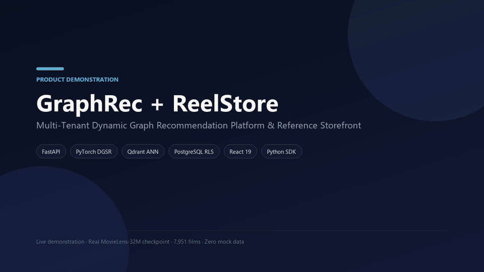
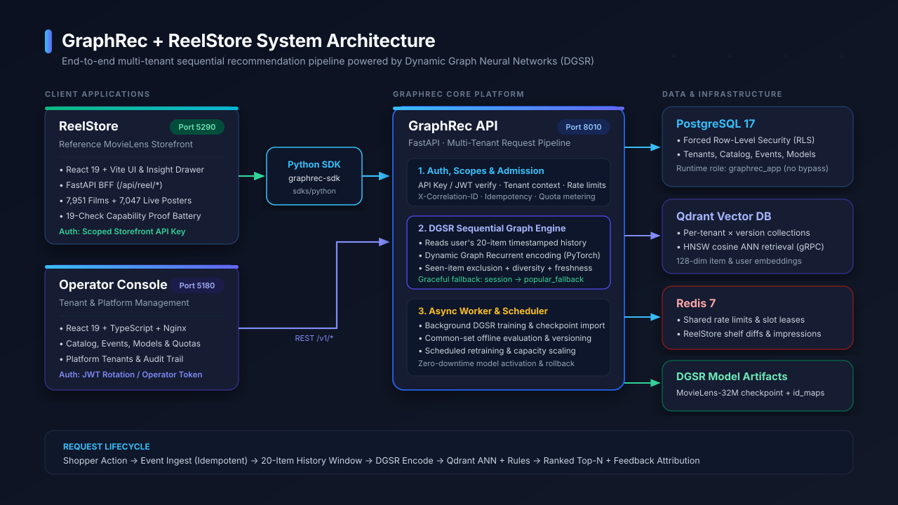

# GraphRec & ReelStore

**A multi-tenant, graph-based sequential recommendation platform (`GraphRec`), its typed client library (`graphrec-sdk`), and its reference MovieLens storefront (`ReelStore`).**

> Developed as the Software Project Lab III (SPL-3) project at the Institute of Information Technology (IIT), University of Dhaka.

---

## Live Product Demo



*720p MP4 master: [docs/demo/graphrec-reelstore-demo.mp4](docs/demo/graphrec-reelstore-demo.mp4) · Storyboard: [docs/demo/storyboard.md](docs/demo/storyboard.md)*

---

## Projects in This Repository

| Project | Path | Description |
|---|---|---|
| **GraphRec** | [`graphrec/`](graphrec/README.md) | Multi-tenant recommendation platform: FastAPI `/v1` API, PyTorch **DGSR** training & serving engine, background worker & scheduler, PostgreSQL 17 with forced Row-Level Security (RLS), Redis 7, Qdrant vector search, and a React 19 operator console. |
| **ReelStore** | [`reelstore/`](reelstore/README.md) | Independent MovieLens reference storefront (FastAPI + React 19) serving 7,951 films with an interactive **Insight** drawer and an on-demand 19-check **Capability Proof Battery** backed by GraphRec. |
| **Python SDK** | [`sdks/python/`](sdks/python/README.md) | Shared typed client library (`graphrec-sdk`) covering the Storefront, Tenant Admin, and Platform Operator API surfaces. |

---

## Architecture

ReelStore operates as a standalone client application that communicates with GraphRec strictly over HTTP via the shared Python SDK (`sdks/python`), mirroring how any production e-commerce storefront integrates with GraphRec.



### Key Capabilities

- **Strict Multi-Tenancy**: PostgreSQL 17 forced Row-Level Security on every tenant-owned table, non-bypass runtime role (`graphrec_app`), and isolated Qdrant collections per `tenant × model version`.
- **Sequential Graph Recommendations**: PyTorch implementation of **DGSR** (*Dynamic Graph Neural Networks for Sequential Recommendation*, IEEE TKDE 2022) encoding each user's recent timestamped history with seen-item exclusion, diversity controls, and graceful popularity fallback.
- **Scoped Access & Security**: Granular storefront `ApiKey` scopes, JWT sessions with single-use refresh rotation, attributed platform operator accounts, Redis-backed rate limits, and idempotent event ingestion.
- **End-to-End Observability**: Structured JSON logs with `X-Correlation-ID`, `/healthz`, `/readyz`, `/metrics`, and ReelStore's glass-box Insight drawer for inspecting live sequence windows, rank diffs, and capability proofs.

---

## Repository Structure

```text
GraphRec/
├── graphrec/                  # GraphRec multi-tenant recommendation platform
│   ├── apps/api/              # FastAPI HTTP API, middleware, and versioned /v1 routers
│   ├── graphrec_core/         # Domain services, auth, billing, DGSR model & serving pipeline
│   ├── migrations/            # Alembic PostgreSQL migrations (forced RLS)
│   ├── infrastructure/        # Postgres runtime role init & production Caddyfile
│   ├── scripts/               # OpenAPI export, SDK doc generation, backup/restore & eval
│   ├── tests/                 # Unit, integration, and e2e test suites
│   ├── web/                   # React 19 + TypeScript + Vite operator console & docs portal
│   ├── docs/                  # API, SRS, security, performance, deployment & ops docs
│   ├── Dockerfile             # Multi-stage API / worker / scheduler image
│   └── docker-compose.yml     # Full platform stack (+ docker-compose.prod.yml TLS overlay)
├── reelstore/                 # ReelStore reference MovieLens storefront
│   ├── app/                   # FastAPI BFF, Redis shared state, proof battery & observability
│   ├── frontend/              # React 19 + TypeScript + Vite storefront UI & Insight drawer
│   ├── data/                  # MovieLens catalog, personas, model card & cover manifest
│   ├── scripts/               # Tenant bootstrap, cover mapping, CLI proof & e2e scripts
│   ├── tests/                 # Backend unit and contract tests
│   ├── e2e/                   # Dedicated Playwright browser tests
│   ├── docs/                  # ReelStore deployment & operations runbooks
│   ├── Dockerfile             # Multi-stage storefront image
│   └── docker-compose.yml     # Standalone Compose project joining GraphRec's network
├── sdks/                      # Shared client SDKs
│   └── python/                # graphrec-sdk package, examples, unit & AST contract tests
├── docs/demo/                 # Product demo GIF, MP4 master, storyboard & architecture SVG
├── .github/                   # CI/CD workflows, issue templates & PR template
├── CHANGELOG.md
└── CONTRIBUTING.md
```

---

## Technology Stack

| Layer | Technologies |
|---|---|
| **Backend & API** | Python 3.12+, FastAPI, SQLAlchemy 2, Alembic, Pydantic v2 |
| **Recommendation Model** | PyTorch **DGSR** (*Dynamic Graph Neural Networks for Sequential Recommendation*) |
| **Storage & Retrieval** | PostgreSQL 17 (forced RLS), Qdrant (HNSW cosine ANN via gRPC), Redis 7, RustFS (optional S3 covers) |
| **Frontends & Testing** | React 19, TypeScript, Vite, Nginx, Vitest, Playwright, Pytest |
| **Deployment** | Docker, Docker Compose, Caddy (automatic TLS production overlay) |

---

## Quick Start

### 1. Start GraphRec

```bash
cd graphrec
cp .env.example .env           # configure secrets as needed
docker compose up -d --build
```

| Service | Local URL |
|---|---|
| Operator Console & Developer Docs | `http://localhost:5180` |
| GraphRec API (`/v1`) | `http://localhost:8010` |
| Qdrant Vector DB | `http://localhost:6333` |

### 2. Start ReelStore (Reference Storefront)

With GraphRec running, bootstrap a ReelStore tenant and launch the storefront from the repository root:

```bash
docker compose -f reelstore/docker-compose.yml --env-file graphrec/.env run --rm reel-bootstrap
docker compose -f reelstore/docker-compose.yml up -d --build reel
```

ReelStore will be available at `http://localhost:5290`.

---

## Documentation

- **GraphRec Platform**: [graphrec/README.md](graphrec/README.md) — [API](graphrec/docs/API.md) · [Deployment](graphrec/docs/DEPLOYMENT.md) · [Operations](graphrec/docs/OPERATIONS.md) · [Security](graphrec/docs/SECURITY.md) · [Performance](graphrec/docs/PERFORMANCE.md) · [Decisions](graphrec/docs/DECISIONS.md) · [Traceability](graphrec/docs/TRACEABILITY.md)
- **ReelStore Storefront**: [reelstore/README.md](reelstore/README.md) — [Deployment](reelstore/docs/DEPLOYMENT.md) · [Operations](reelstore/docs/OPERATIONS.md)
- **Python SDK**: [sdks/python/README.md](sdks/python/README.md)
- **Contributing**: [CONTRIBUTING.md](CONTRIBUTING.md) · **Changelog**: [CHANGELOG.md](CHANGELOG.md)

---

## Acknowledgements

- **Supervisor**: Dr. Rezvi Shahariar, Associate Professor, IIT, University of Dhaka
- **Author**: Hasin Ahmed — BSSE, IIT, University of Dhaka
- **Model Reference**: Zhang et al., *Dynamic Graph Neural Networks for Sequential Recommendation*, IEEE TKDE 2022
- **Dataset**: [MovieLens](https://grouplens.org/datasets/movielens/) by GroupLens Research
